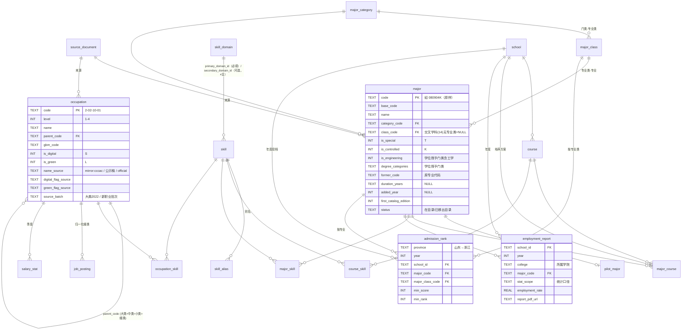

# CAREER：志愿填报 / 职业规划数据

思路是从就业市场倒推：**职业 → 技能 → 专业/课程 → 院校**。
里程碑 1 只做两张主表，数据要完整、准确、可溯源：**专业主表**（教育部本科专业目录）和 **职业主表**（职业分类大典 2022）。其余表目前只建了结构，还没有数据。

## 目录结构

```
CAREER/
  migrations/001_init.sql              # 全部表结构（版本化迁移）
  migrations/002_seed_skill_domains.sql# 一级能力域种子（草案，待专家审核）
  migrate.ts                           # 迁移执行器（schema_migrations 表记录已执行的版本）
  db.ts                                # 数据库路径：$SPIDERS_DATA_DIR/career.db（默认 data/career.db）
  sources.ts                           # 官方文件清单（规范 URL、实际下载 URL、公告页）
  fetchdoc.ts                          # 下载器：遵守 robots.txt、限速、诚实 UA；PDF 存到 data/raw/career/
  moe_majors/crawler.ts + clean.ts     # 本科专业目录（2026 最新版 + 2025 版，用于对比差异）
  occupations/crawler.ts + clean.ts    # 职业分类大典 2022 分类体系表
  ingest.ts                            # 迁移 → upsert → 种子 → 重建 FTS
  dataset.ts                           # Web 控制台里的三个数据集：专业 / 专业类 / 职业
  seeds/pilot_majors.csv               # 25 个试点专业（专家决定）
  seeds/schools_pilot.csv              # 50 所试点院校（专家名单 2026-10-12）
```

## 运行

```bash
npm run career:all          # crawl + clean 两个爬虫，然后 ingest（等同 tsx scripts/run-group.ts CAREER）
npm run career:migrate      # 只执行迁移（幂等；Web 服务启动时也会自动执行）
npm run career:ingest       # 只入库（会先执行迁移）
# 在 Web 控制台「爬虫管理」→ CAREER 里也能跑；数据在「数据查询」→ CAREER · 本科专业目录 / 专业类 / 职业分类大典 2022
```

如果服务器连不上下载地址，可以手动下载官方 PDF，再把本地文件传给爬虫：
`npm run crawl:career-majors -- --file=moe-major-catalog-2026=/path/x.pdf`（职业表的参数是 `--file=osta-occupation-2022-table=...`）。
下载失败时，爬虫会复用 `data/raw/career/` 里已缓存的 PDF。

## 数据库与可移植性

- 目前用 SQLite：`data/career.db`，路径跟随 `SPIDERS_DATA_DIR`，服务器上是 `/opt/spiders/data/career.db`。
- 迁移 SQL 按 PostgreSQL 可移植的写法：
  - 只用 TEXT、INTEGER、REAL 三种类型；
  - 布尔值存成 0/1，并加 CHECK 约束；
  - 时间用 ISO-8601 文本；
  - 不用 AUTOINCREMENT，也不用 SQLite 专有语法；
  - upsert 用的是 PG 同样支持的 `INSERT … ON CONFLICT (…) DO UPDATE`。
- 迁移到 PG 时，只需要换掉 `migrate.ts` 和 `ingest.ts` 里的驱动；FTS5 部分换成 PG 全文检索或 pg_trgm。
- 已执行的迁移不要再改：`schema_migrations` 存了校验和，改动后会告警。需要改结构就新增 `003_xxx.sql`。
- 每张数据表都带溯源字段：
  - `source_url`、`source_doc_id`（关联 `source_document`，表里记录 sha256、实际下载地址和是否官方）；
  - `source_page`、`fetched_at`；
  - `extraction_method`（pdf_parse / llm / manual / expert）；
  - `confidence`、`reviewed`。

## 数据模型



## 数据来源与现状（2026-10-12）

| 表 | 来源 | 行数 | 说明 |
|---|---|---|---|
| major / major_class / major_category | 教育部《普通高等学校本科专业目录（2026年）》（教高函〔2026〕2号附件），[公告](http://www.moe.gov.cn/srcsite/A08/moe_1034/s3882/202604/t20260427_1434931.html)，[PDF](http://www.moe.gov.cn/srcsite/A08/moe_1034/s3882/202604/W020260427440749576927.pdf)；另加 2025 年版（教高函〔2025〕3号附件2），只用来对比差异 | 13 门类、92 专业类、**883 专业（在目录）**；**工科 329 个**（按学位授予门类含工学判定，003 迁移起；按门类 08 统计为 293 个）；另有 11 个"已移出目录"的专业和 1 个已移出的专业类（0832 交叉工程类），都是 2026 年整体迁到 14 交叉学科的，新代码的 `former_code` 指向原代码 | 与教育部公告的"13 个门类、92 个专业类、883 种专业"一致。2025 年版解析结果是 12/93/845，也与官方一致。PDF 实际从教育部官方镜像 `hudong.moe.gov.cn` 通过 https 下载（box 没有 80 端口出网），`source_url` 记录的是 moe.gov.cn 的规范地址 |
| pilot_major | 专家决定（25 个） | 25 | 代码和名称逐一与 2026 年目录核对，**全部一致** |
| occupation | 《中华人民共和国职业分类大典（2022年版）》分类体系表 | 大类 8、中类 79、小类 450、**细类 1639**；数字职业 S 97 个、绿色职业 L 134 个，其中 L/S 23 个 | 1639 个细类、S 97、L 134、L/S 23 都与人社部正式颁布时公布的数字一致（公示稿是 1636 个细类、L 133 个）。人社部官网的公告页和附件放在 JS 反爬挑战（EdgeOne）后面，我们**不绕过**，所以表格 PDF 取自公开镜像（cccac.org.cn 链接的 aliyuncs OSS 文件）。这些行 `source_document.is_official=0`，`confidence=0.9`，`reviewed=0`，需要人工对照官方附件后再标记为已审核。另外用 1.3 万行公示稿正文做了独立交叉校验：1585/1639 个细类名称完全一致，其余是正式版改名、重新编号或公示稿里的长名被截断 |
| school | 专家名单（2026-10-12） | 50 | 只有名称和分层（省内 15 / 省外头部 10 / 省外中上 15 / 省外行业特色校 10）；学校标识码和省份待补 |
| skill_domain | 专家修订版（003 迁移，source='expert 2026-10-12'，reviewed=1） | 20 | 二级技能刻意留空 |
| occupation_draft_2022 | 公示稿正文（m12333.cn 镜像）经 `CAREER/tools/draft_2022.py` 提取，提交为 `seeds/occupation_draft_2022.csv` | 1635 | 用于按专家决定以公示稿补 S/L 标注；名称差异见 `review/occupation_name_diff.csv`（54 行，未审核） |
| 其他表 | — | 0 | 只有结构 |

### 已知缺口

- **修业年限**：目录"说明"第五条写明"基本修业年限为四至五年……专业目录不再单独列出"，所以 `duration_years` 为 NULL。
- **增设年份**：最新版目录不标注增设年份。目前只能通过版本对比得到 `first_catalog_edition`：2026 年新列入的 38 个专业加上 11 个迁移专业，共 49 个代码标为 2026，其余标为 2025，意思是"至少 2025 年就已存在"。`added_year` 要等以后解析教育部历年《本科专业备案和审批结果》，在那之前保持 NULL。
- **"已撤销"状态**：目录只列现有专业。本次新增的 `已移出目录` 只覆盖"2025 年版有、2026 年版没有"的代码，全部是迁到交叉学科的；专业设置调整的历史还没有导入。
- **职业来源的官方性**：见上表。如果能拿到人社部官网附件（比如在国内服务器上或手工下载），用 `--file=osta-occupation-2022-table=…` 重跑即可，sha256 会写进 `source_document`。
- **2022 年后的新职业**（人社部分批发布，`source_batch` 字段已预留）：发布页面同样在 mohrss.gov.cn 的反爬挑战后面，**本次未导入**。
- 小类解析出 450 个，正式颁布的公告只给出细类、S、L 的数量，没有核对小类数量的官方数字（公示稿是 449 个）。其中"X-XX-99 其他……"这类小类按惯例没有细类。

### S/L 标注与名称溯源（003）

- 入库后会用公示稿的 S/L 标注补全缺失的标记（按专家决定以公示稿为准）。匹配方式：先按同名匹配，找不到时再按"同代码 + 名称前缀"匹配，1622/1639 能匹配上。目前**补入 0 个**：两份来源在共有职业上的标注完全一致。
- `digital_flag_source` / `green_flag_source` 的取值：`mirror:cccac`（只有镜像体系表有标注）、`公示稿`（由公示稿补入）、`mirror:cccac+公示稿`（两者一致）。
- 绿色职业数 133 和 134 的差别来自 2-02-27-07 碳管理工程技术人员：它是正式版新增的职业，公示稿里没有，标注为 L。
- `name_source` 目前都是 `mirror:cccac`；以后用官方文件重跑时会写成 `official`。

### 专家审核结论（004，2026-10-12）

- **职业主表已审核**：所有 occupation 行 `reviewed=1`，`reviewer_note='expert 2026-10-12'`。镜像文件的 `source_document.is_official` 仍为 0，但专家判断 cccac 镜像与正式印刷版（2022 年版）一致。审核只对当前这个文件有效：如果镜像文件内容变了（sha256 不一致），ingest 会把所有行重新标为 `reviewed=0`。
- **名称差异**：`review/occupation_name_diff.csv` 已加上 `decision`、`alias_added`、`decided_by` 三列，状态为已决。
  - 15 处真实差异一律采用导入的名称，`name_source='official-2022 (via mirror:cccac, expert-verified)'`；其余 39 行只是 PDF 换行造成的，不需要改。
  - 8 个改名职业的公示稿旧名存入 `occupation_alias`（`alias_type='公示稿旧称'`），控制台的职业搜索也会匹配别名，例如搜"民办非企业单位负责人"能找到 1-04-03-00。
  - 3 个代码顺延的职业（2-05-07-13、2-07-08-00、4-07-03-07）不加别名，因为它们的旧名现在属于下一个代码，已核对一致。
- **工科**：仍按"学位授予门类含工学"判定，共 329 个。新增 `engineering_degree_type` 字段，取值 `only`（只授工学，291 个）或 `optional`（可授工学，同时可授其他门类，38 个）。新增 `degree_display` 字段用于控制台显示，例如工程管理显示为"可授工学/管理学"。
- **一级能力域**：保持 20 个，不合并。

## 010：信息安全基础

- 新增二级技能 `network-sec.infosec-basics` 信息安全基础（专业知识）。专家口径：信息安全导论 → 信息安全基础 + 密码学（按课程名推断）；大数据管理与分析 → 只挂数据清洗与处理，大数据平台（Hadoop/Spark）没有例外，原文没写就不挂。

## 009：核心课口径、证据化打标签、技能类型

- **核心课**：`is_core=1` 只看正文「核心课程」段落（`core_in_section`）。只在课程表「专业核心课程」块里的课程记为 `is_core=0`，界面标「专业必修」（`course_type=必修`），`table_block` 只是来源。对所有学校生效，抽取和入库都按这条算。
- **技能类型**（专家定）：`工具与技术` = C/C++、Java、Python、数据库与SQL、Linux使用、Web前端、后端开发、大数据平台（Hadoop/Spark）、商业智能工具、FPGA、大模型应用；其余都是 `专业知识`。新增二级技能 `software.graphics` 计算机图形学（专业知识）。
- **证据化打标签**（prompt `course-skill-v3.1-evidence`，旧缓存失效）：
  - 打标签时把培养方案原文中提到这些课程的行（含前后各一行）一起发给模型，每个技能必须附一段逐字引用 `evidence_quote`。
  - 代码校验引用是否出现在原文里（去掉空白和表格分隔符 `|` 后做子串匹配）。
  - 工具类技能只有原文写出了对应工具才保留（如 FPGA 需要出现 FPGA / 硬件描述语言 / Verilog / VHDL），否则直接丢弃，只留知识类技能。
  - 没有引用、引用在原文里找不到、或理由里有「可能/常用/一般/通常/或许/大概」，记 `needs_review=1` 并写 `review_reason`，不算已接受。009 之前的旧标签全部标为待复核。
- **控制台 课程审核**：新增「技能 · 标签依据」列，显示每个技能的原文引用和复核原因；勾选「只看标签待复核」只列出含 `needs_review` 标签的课程。

### 011 依据类型 + 按课程缓存（2026-10-13，专家口径）

- `course_skill.evidence_type`：`原文明确`（原文在课程名之外写了相关内容）| `课名推断`（只有课程名/表格行）。模型给出类型，代码复核：引用里除课程名（及其它课程名、课程号、学分学时等表格字段）外没有内容，或引用核对不上原文，一律降为 `课名推断`。课程名本身写出工具（如“数据库系统”→数据库与SQL）算原文明确。
- 课名推断在代码里强制：最多 2 个技能，且不能是「工具与技术」。“计算概论”这类宽泛课名不挂（提示词约束）。
- 推荐权重 `EVIDENCE_WEIGHT`（`CAREER/curriculum/skills.ts`）：原文明确 1.0、课名推断 0.5；`course_skill.weight` = 依据权重 × 排名系数（1 / 0.75 / 0.5）。
- 稳定性：每门课的校验后结果存 `course_skill_tag_cache`，键 = sha256(模型 + 课程名 + 该课自己的原文行 + `TAG_RULES_VERSION`（提示词版本+校验版本）+ 技能表哈希)。只有键变了的课才重新发给模型；`course_skill` 按差异更新，没变的行一个字节都不动（rowid、tagged_at 不变）；`reviewed=1` 的行永远不改不删。
- 课程审核页显示每个标签的依据类型和权重，可按「依据类型」筛选。

### 012 核心课名 + 工具标签字面规则（2026-10-13，专家口径）

- 新依据类型 `核心课名`，权重 0.8：课程是正文列出的核心课（`is_core=1`），且课程名基本就是技能名。判定是代码里的确定性规则，保守：先查显式映射表 `CORE_NAME_MAP`（操作系统→操作系统原理、编译原理、数据结构与算法、软件工程→软件工程方法、离散数学、计算机网络→计算机网络协议、计算机组成与系统结构→计算机组成与体系结构 等）；不在表里的，两边去掉结尾括号和后缀（与体系结构/与系统结构/体系结构/原理/方法/协议/系统）后必须完全相等。包含、近义一律不算（算法设计与分析≠数据结构与算法，计算机系统导论、人工智能引论都不算）。
- 这是打标签之后的后处理 `classifyCoreNames`（`CAREER/curriculum/tag.ts`）：不调模型，不改挂哪些技能，不进打标签缓存键（版本 `CORE_NAME_VERSION` 与 `TAG_RULES_VERSION` 分开）。只改 `evidence_type` 和 `weight` 两列；已审核的行也会更新这两列，技能、引用、审核状态、tagged_at 都不动。重复运行 0 改动。
- 权重常量 `EVIDENCE_WEIGHT`：原文明确 1.0、核心课名 0.8、课名推断 0.5。`weight` 就等于这个值，不乘排名或置信度；模型给的先后顺序单独存在 `tag_rank`（013），只用于审核页排序。
- 工具类技能：只有工具名字面出现在课程名里（Python程序设计、Linux系统管理），或引用里除课程名之外的原文写出了该工具，才算原文明确；`数据库系统→数据库与SQL` 是专家批准的例外，放在白名单 `TOOL_NAME_WHITELIST`。其余工具标签一律丢弃。
- 课程审核页「依据类型」筛选增加 核心课名。

## 008：抽取全部课程，核心课的两种来源分开记录

- 现在抽的是培养方案课程表里的全部课程（必修、限选、任选），再加上「核心课程设置」段落里列出的课程。新的 prompt 版本是 `curriculum-all-v2`。
- `tables.ts` 按「课程类别」把课程表切开，每个类别一块。每块都带上表名、表头和拼好的竖排类别名提示，保证一行课程和它的类别、学分在同一块里。「应修小计」行是块的结束标志。
- `major_course` 的字段：
  - `course_type`：必修 / 限选 / 任选 / NULL。005 里旧的「核心/主干」那一列改名为 `core_type_legacy`，不再写入。
  - `core_in_section`：课程是否出现在「核心课程设置」段落里。
  - `table_block`：课程表里的类别块名称，例如 专业核心课程。
  - `module`：模块，例如 系统与安全模块。
  - `is_core`：见 009，只有正文「核心课程」段落里列出的才是 1，其余一律 0。
- 重新抽取：`npm run clean:career-curriculum -- --refresh`，会跳过缓存直接问模型。同一来源、同一专业下，新结果里已经没有的待审核行会被删掉。

## 培养方案 → 专业核心课（005，curriculum/）

流程：`seeds/curriculum_sources.csv`（专家填链接）→ `curriculum/crawler.ts`（礼貌抓取：robots.txt、按域名间隔 `SPIDERS_DELAY_MS`、真实 UA；原件存 `data/raw/career/curriculum/<id>.<ext>`，sha256 记入 `source_document`）→ 文本抽取（PDF: unpdf 按页、表格单元格用 ` | ` 分隔；HTML: cheerio；DOCX: mammoth；旧版 .doc 不支持，请要 PDF/DOCX）→ `curriculum/clean.ts`（LLM 抽取）→ `career:ingest`（写 `course` / `major_course`，`extraction_method='llm'`、model、confidence、页码、原文片段、`reviewed=0`、`review_status='pending'`）→ 控制台 **课程审核**（`#/review`）逐条 通过/驳回/修改，记录审核人和时间。

- 格式只按文件头识别（PDF 以 `%PDF-` 开头，DOCX 以 zip 的 `PK` 开头），不看服务器的 Content-Type（很多下载接口返回 `application/octet-stream`）；文件头不符（登录页、反爬页）直接报错。
- 从清单删掉的行不当历史保留：`crawl` 会删掉它缓存的原件，`career:ingest` 会删掉对应的 `curriculum_source`、分段记录和待审核（pending）的 `major_course`；已审核过的行保留但去掉来源关联，并打警告。

清单列：`school,major_code,grade_year,url,format,verified_by,notes`（format = pdf|html|docx|doc；major_code 为单个代码、`080901|080902` 列表，或 `*`（全校/学院汇编：按「××专业培养方案（代码）」标题切分，抽取其中的试点专业；菁英班/实验班等班级变体只记录在 `curriculum_source_major` 与 `sections_note`，不映射新专业代码；非试点专业只记录）；每个 url 只能出现一行，文件只下载一次（sha256），之后复用，`crawl:career-curriculum -- --refresh` 才重新下载；major_code 必须在 major 表；学校按校名对应 `school`，没有则自动新建 `name:<校名>`）。只收 专业核心课/主干课，不收选修。

环境变量（服务器上写入容器 env；不配置则为 mock 模式）：

| 变量 | 说明 |
|---|---|
| `LLM_BASE_URL` | OpenAI 兼容地址，如 `https://api.deepseek.com/v1`、`https://dashscope.aliyuncs.com/compatible-mode/v1`、`https://api.openai.com/v1` |
| `LLM_API_KEY` | 密钥 |
| `LLM_MODEL` | 如 `deepseek-chat`、`qwen-plus`、`gpt-4o-mini` |
| `LLM_JSON_MODE` | 默认开启 `response_format=json_object`；不支持的服务设 `0` |
| `LLM_CHUNK_CHARS` | 每块最大字符数，默认 6000 |
| `LLM_MAX_CALLS` | 每次 clean 最多付费调用次数，默认 200（也可 `-- --max-calls=N`） |
| `LLM_TIMEOUT_MS` | 默认 120000 |
| `LLM_MOCK=1` | 强制 mock |
| `CURRICULUM_MANIFEST` | 替换清单路径（测试用） |

命令：

```bash
npm run career:curriculum:try -- --url='<链接>' --format=pdf --school=山东大学 --major=080901   # 单个链接试跑，不写库 -> data/tmp/curriculum-try.json
docker exec spiders npx tsx scripts/run-group.ts CAREER curriculum                            # 只跑培养方案：抓取 -> 抽取 -> 入库
docker exec spiders npm run career:all                                                        # 全部（清单为空时课程这一步 0 条）
npm run test:career                                                                           # 离线测试（无需 key）
```

防编造：mock（未配置 LLM）结果带 `mock:true`，ingest 跳过，绝不入库；模型返回的每门课都必须给出原文片段，片段须在该块原文中逐字出现（忽略空白和 ` | `）且包含课程名，否则丢弃；JSON 按 schema 严格校验；同名课程合并，保留置信度高者。已审核（approved/rejected/edited）的行重跑不会被覆盖；文档 sha256 变了而未重新抽取时不入库。

成本控制：只把含 核心课/主干课/课程设置/学位课/教学计划 等关键词的块发给模型；按 sha256(model+提示词版本+块) 缓存在 `llm_cache`，重跑不重复付费（改模型或 `PROMPT_VERSION` 才会重新调用）；temperature 0；`LLM_MAX_CALLS` 硬上限；日志打印每份文档的块数、调用数、token 数。实测山大 080901（16 页）≈ 3 块、约 9k 输入 token/份；25 专业 × 4 校 ≈ 100 份 ≈ 100 万输入 token。

就业/教学质量报告（006，仅表结构）：`employment_report.report_type` = 就业质量报告 | 本科教学质量报告，新增 graduation_rate（本科毕业率）、placement_rate（去向落实率）、degree_rate、report_source_id（升学率 further_study_rate、出国率 abroad_rate 已有）；链接清单 `seeds/report_sources.csv`（school,report_type,year,url,format,verified_by,notes），ingest 时同步到 `report_source`，暂不抽取。

第二阶段（课程 → 技能）：见下方「课程 → 二级技能打标签」。

## 全量课程抽取（008，curriculum/tables.ts）

- 抽取范围从「核心课/主干课」扩大到课程设置表里的全部课程（必修、限选、任选），每门课带学分、学时、学期、类别块（`table_block`）和模块（`module`）。
- 分块：「核心课程设置」段落单独作为一块；课程表按课程类别切块，以「应修小计」作为块的结束，每块都带上表名、表头，以及竖排类别标签的碎片拼接（例如「学科/平台/基础/课程」拼成「学科平台基础课程」）。这样学分不会因为跨块或跨页而丢失。认不出课程表时，退回原来的关键词分块。
- `major_course.course_type` 的取值现为 必修/限选/任选；005 时的「核心/主干」保留在 `core_type_legacy` 列，不再写入。
- 核心课分两个事实分别存：`core_in_section`（课程是否列在「四、核心课程设置」里）和 `table_block`（课程在课程表里的类别块）。`is_core` 取值（009 专家规则，所有学校通用）：1 = 正文「核心课程」段落中列出；否则 0。只出现在课程表「专业核心课程」块里的课程显示为「专业必修」（course_type 必修），`table_block` 只作来源记录。
- `npm run clean:career-curriculum -- --refresh` 会忽略缓存重新调用大模型。ingest 会删掉最新一次抽取里已经没有、而且还没审核的旧行。
- 打标签时，两个核心事实满足任意一个就按核心课处理；通识课（思政、英语、体育等）对不上技能清单时进入未打标签列表。

## 课程 → 二级技能打标签（007，curriculum/skills.ts + tag.ts）

- 迁移 007 写入专家给的第一批二级技能：6 个计算机相关一级域共 36 个（id 形如 `software.dsa`）。名称按专家原文，reviewed=1；`skill_type`（专业知识/工具与技术）是开发先填的，等专家确认。
- `npm run career:tag-skills`：每个「学校×专业」调用一次大模型，给每门课挂 1–3 个技能，只能从清单里选（清单外的 id 直接丢掉）。核心课要求至少挂 1 个，但对不上的课不硬挂，写进 `course_skill_untagged` 并附原因，交给专家决定是否补技能。
- 写入 `course_skill`（extraction_method='llm'，source='llm:<model>'，附一句 rationale，reviewed=0）；已审核的行不会被覆盖。结果按 sha256(模型+prompt 版本+输入) 缓存在 llm_cache，重跑不重复花 token；mock 模式什么都不写。
- `career:all` 跑完 ingest 后会自动执行 `CAREER/post_ingest.ts`，也就是打标签这一步（见 scripts/run-group.ts）。

## 定时任务（deploy/cron/spiders-career）

- 每月 1 日 03:17（Asia/Shanghai，`CRON_TZ`）在服务器上跑 `docker exec spiders npm run career:all`，用 `flock -n /tmp/spiders-career.lock` 防止和手动运行重叠，日志写到 `/var/log/spiders-career.log`。
- 每次部署时 `deploy/deploy.sh` 都会把这个文件装到 `/etc/cron.d/spiders-career`，内容没变就跳过。改时间只需改仓库里的这个文件。

## 专家决策（取代原来的开放问题）

1. **省份**：先做山东（专业(类)+院校模式，最多 96 个志愿，每个志愿对应一个专业(类)；山东省教育招生考试院每年公布一分一段表和投档线），再做浙江。`admission_rank` 粒度是"院校 × 专业(类) × 年 × 省"，字段包括最低分和最低位次；按专业类招生时填 `major_class_code`。
2. **试点 25 个专业**：080901 080902 080903 080904K 080910T 080701 080702 080703 080704 080717T 080601 080801 080803T 080202 080204 080207 080216T 080501 080503T 080401 081001 081301 082502 081801 082001。存放在 `pilot_major` 表（Web 控制台里的主题"试点专业(25)"），已核对，无差异。
3. **技能体系分两级**（每个技能有且只有一个主能力域，可选一个次能力域）。一级能力域已由专家修订并确认（2026-10-12，共 20 个，不合并）：工程基础、软件开发、数据分析、人工智能、网络与信息安全、电路与硬件、集成电路与微电子、通信技术、自动化与控制、电气工程、能源与动力、机械设计、车辆工程、航空航天、材料、化工与环境、土木与交通、测试与质量、产品与项目管理、通用职业能力。其他规则：
   - 一级是能力域（15～20 个）；
   - 二级是 JD 粒度的具体技能（目标 300～500 个，不区分版本）；
   - 每个技能有类型：专业知识 / 工具与技术 / 通用能力；
   - 别名单独建 `skill_alias` 表；
   - 现在只给出一级种子草案，二级暂不列。
4. **招聘数据源**（后续里程碑）：
   - 社招先做智联招聘、前程无忧，BOSS 直聘和猎聘反爬较强，放到以后；
   - 校招做应届生求职网、实习僧、国聘；
   - 合规要求：只采集公开的岗位信息，不采集个人信息，限速，只存结构化字段和用于统计的 JD 文本。
5. **就业质量报告**：
   - 覆盖约 50 所山东考生常报的院校，名单已放在 `seeds/schools_pilot.csv`，报告链接以后由专家提供；
   - `employment_report` 按"校 × 年（× 学院 / 专业，如果报告里有）"存储，带 `stat_scope`（统计口径：按学院还是按专业、就业率是否含升学、统计截止日期）、`college`（所属学院）和来源 PDF 地址。

## 路线图

1. ✅ 里程碑 1：两张主表 + 全部表结构 + 试点种子。
2. 职业主表补全：
   - 用官方附件复核（把 `reviewed` 标为 1）；
   - 导入 2022 年后人社部各批新职业（`source_batch`）；
   - 导入历年《本科专业备案和审批结果》，补 `added_year` 和撤销记录。
3. 培养方案：抽取试点 25 个专业 × 试点院校的课程（LLM 抽取 + 人工抽检，`extraction_method='llm'`、`reviewed`），建立 `major_course` 和 `course_skill`。
4. 二级技能表（300～500 个）和别名：从 JD 统计中提取候选，再由专家审定。
5. 招聘数据采集（智联、前程无忧 → 应届生、实习僧、国聘），归一化到细类，生成 `occupation_skill` 和季度 `salary_stat`。
6. 50 所院校的就业质量报告（PDF 解析或 LLM，带统计口径）。
7. 山东投档线和一分一段表（`admission_rank`），之后做浙江。

## 还需要确认的问题


### 013 审核过的行也刷新原文事实（2026-10-13 服务器 bug）

服务器上 19 门课在 008 之前就被审核通过了。入库的 upsert 只更新 `review_status='pending'` 的行，所以这 19 行一直停在 008 新列的默认值（`core_in_section=0`、`course_type=NULL`），009 再按 `core_in_section` 重算 `is_core`，结果全部变成 0，核心课名也就是 0。现在入库对已审核的行也刷新原文事实（`core_in_section`、`table_block`、`module`、`is_core`；`course_type` 只补空值），审核状态和审核人改过的学分等字段不动。修复只用缓存的抽取结果，不花 token。
